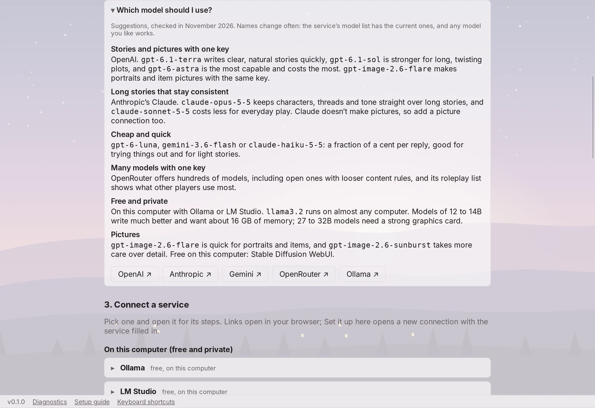

# Dear to Love

Dear to Love is a desktop app for playing interactive stories with AI. Pick a world, a
character and a situation, write what you do, and the storyteller writes what happens next
and plays everyone else. Cozy romance, dungeon raids with a party, cyberpunk resistance,
horror, mystery, school life, and explicit stories for adults all work.

Everything stays on your computer: your stories, saves and pictures. You bring your own AI,
either a service like OpenAI or Claude with your API key, or a free model running on your own
computer. A built-in offline storyteller lets you play with neither.

Windows, macOS and Linux. The app is in English, Simplified Chinese, Traditional Chinese,
Japanese and Korean, and stories can be written in many more languages.


## Highlights

- **Start in a few clicks** from 33 worlds, 35 scenarios and 27 characters, or build your
  own story from scratch.
- **Tell it your way**: narrated, script (like the story above), roleplay chat, thoughts and
  dialogue, mostly messages, or a classic text adventure, each with an example before you
  choose.
- **Texts and phone calls** show up as phone cards, written the way each character really
  texts and talks. You can text and call them too.
- **RPG tracking**: health and mana bars, counters such as gold, and an inventory with item
  descriptions and pictures. The storyteller changes them as things happen.
- **Dice** for risky moments, with every rule adjustable.
- **Picture view**: the scene's background and the portrait of whoever you are with, like a
  visual novel. One click switches to text only.
- **Play several stories at once**, branch from any moment, and keep long stories consistent
  with automatic memory.
- **Made for reading**: a book font, chapters that open like a book's, each character's name
  in their own color, and three themes (Rose, Midnight and Parchment). A story can take the
  look that fits its genre.
- **Every feature can be switched off** with a checkbox.

## Download

> **Downloads arrive with the first release.** Dear to Love is still being built, so there is
> no installer on the [Releases page](https://github.com/TheMiniMingg/Dear-To-Love/releases)
> yet. Until then you can [build it from source](#build-from-source).

<details>
<summary>Which file to pick, and opening an unsigned build</summary>

| System                          | File                                                             |
| ------------------------------- | ---------------------------------------------------------------- |
| Windows 10/11 (64-bit)          | `…_x64-setup.exe` (installs for you only) or `…_x64_en-US.msi`   |
| macOS (Apple silicon and Intel) | `…_universal.dmg`: open it and drag Dear to Love to Applications |
| Debian, Ubuntu (64-bit)         | `…_amd64.deb`: `sudo apt install ./Dear.to.Love_…_amd64.deb`     |
| Fedora, openSUSE (64-bit)       | `….x86_64.rpm`                                                   |
| Other Linux (64-bit)            | `…_amd64.AppImage`: `chmod +x` it and run it                     |

Each release lists SHA-256 checksums in `SHA256SUMS.txt`.

The builds are not code-signed yet, so your system warns you the first time:

- **Windows:** SmartScreen says it "protected your PC". Choose **More info → Run anyway**.
- **macOS:** right-click the app → **Open**, or System Settings → Privacy & Security →
  **Open Anyway**. If macOS says the app "is damaged", run
  `xattr -dr com.apple.quarantine "/Applications/Dear to Love.app"` in Terminal once.
- **Linux AppImage:** some distributions need `libfuse2` (`sudo apt install libfuse2`).

Installing a newer version keeps your stories. The app never updates itself; turn on update
checks in **Settings → Updates** to be told when a new release is out.

</details>

## Getting started

1. **Preset Story** opens a ready-made story. Pick a type of story, a world, a scenario and
   who you play with the arrows, then **Start story**. To make your own instead, choose
   **Custom Story**.
2. Write what you do and press Enter. Without any setup, the built-in offline storyteller
   answers, so you can try everything first.
3. When you want a real AI storyteller, open the **Setup guide** (in the library, in
   Settings and at the bottom of every screen). It explains which kind of service to pick,
   walks through each one with buttons to its key and model pages, and fills in a new
   connection for you.


## Playing

Write actions in plain words, as long or short as you like, or speak:
`"Who wrote this?" I ask Mara.` The storyteller plays everyone else, from allies to villains,
each with their own goals, and never decides what your character does. The box under the
story can also **Send a text**, **Call** someone, **Think** a thought of your own, or
**Roll dice**.

- **Picture view.** With a background or portraits chosen, a stage above the story shows the
  scene and whoever you are with, and switches when someone new appears. **Picture view**
  beside the story (or Ctrl/Cmd+P) switches to text only and back.
- **Several stories at once.** **Stories** beside the story goes back to the library. A reply
  keeps writing while you play something else, and the library shows "Writing a reply…"
  until it is in. Each story opens where you left it, with your unsent text kept.
- **Save anywhere**: quick-save with Ctrl/Cmd+S, Save / Load, and five autosaves.
- **Branch** from any reply, ask for **another reply**, or **change an earlier action**. Each
  makes a new route and keeps the original. **Routes** shows them as a list, a map of how
  they branch, or a timeline.
- **End a chapter** when it feels finished: the storyteller writes a recap, you can edit it,
  and later chapters remember it.
- **Long stories stay consistent.** Older turns are summarized automatically, so a story can
  run for thousands of turns. As it writes, the storyteller keeps a notebook of what must not
  be forgotten: people, places, things, a timeline and other facts, so the ring you gave in
  chapter 4 is still on her hand in chapter 9. A small "Memory updated" line under the reply
  shows what it noted, with **Undo**. **Story memory** shows everything the storyteller
  remembers and lets you add, change or remove any note while the story goes on, and
  **Preview context** shows exactly what it will read next.
- **Change the story as you go** in **Story details**: characters, the world, the narration,
  the scene and the facts it must keep to.
- **Your library** shows each story as a card with its cover, how far it got and its last
  line. Search, sort and pin stories, and rename, copy or change the cover of one from its
  **…** menu. A reply keeps writing when you leave a story, and a notice (with a soft chime)
  says when it is ready.
- **Where and when** the story is shows above it, and panels such as **Story details** and
  **Story memory** open beside the story instead of over it.
- **Search and bookmarks**, and **Export** a route as text or a whole story as a
  `.storypack` to share.
- **Keyboard shortcuts** for almost everything; press **F1** to see them.
- **Looks.** Stories are set in Literata, a font made for long reading, and each chapter
  opens with its number, its title and a large first letter. Everyone in the cast gets a
  color for their name, picked from the name; change it under **Name color** in **Story
  details**. **Settings → Look** has three themes: Rose (light or dark with your computer),
  Midnight and Parchment. With **Give each story a look that fits its genre** on, horror,
  mysteries and science fiction read in Midnight, fantasy and history on Parchment and
  romance in Rose; **Look** beside the story picks another for that story.


### Texts and calls

Characters text in short bursts, in their own voice, and calls read like real speech. Their
portrait appears on the card. They can text or call you first when they have a reason, or
only answer when you start (a checkbox).


### Adventures with health, mana and items

For stories played like an RPG, a story can track bars (Health 88/100), counters (Gold 35)
and an inventory. The storyteller is told the numbers and writes what changes (a goblin's
spear, a chest with a key in it); the app does the arithmetic and shows each change in the
story. Your bars sit above the action box, and **Inventory** lists the whole party's bars and
every item with its description. **Make a picture** draws an item with your picture
connection, or you can use your own picture.

Most of the new adventure scenarios start with this set up, and you can add or change any
bar, counter or item when creating a story or later in **Story details**. Romance stories
can track things too, such as affection or a gift you were given.


## Stories to start from

Preset Story includes 33 worlds, each with at least one scenario, and 27 characters to play.
Scenarios marked ★ start with health, items and more already set up.

<details>
<summary>All worlds and scenarios</summary>

| World                   | Genres                                      | Scenario                              |
| ----------------------- | ------------------------------------------- | ------------------------------------- |
| Harbor Town             | Mystery, Romance, Slice of life             | The Unsigned Letter                   |
| The Glass Orchard       | Fantasy, Drama                              | The Memory Harvest                    |
| Meridian Station        | Science fiction, Mystery                    | Night Shift on Meridian               |
| Ashcombe, 1923          | Historical, Romance, Comedy                 | The Summer Guest                      |
| Hollow Pines            | Horror, Mystery                             | Dead Air                              |
| The Ember Road          | Fantasy, Adventure                          | The Last Caravan                      |
| Larkport                | Romance, Comedy, Drama                      | The Wrong Reservation                 |
| Vesper City             | Science fiction, Noir, Thriller             | Ghost in the Ledger                   |
| Northgate University    | School life, Romance, Comedy, Slice of life | Midterm Week                          |
| The Underhalls          | Adventure, Fantasy, Action                  | The Lantern Job                       |
| Neon Harbor             | Cyberpunk, Thriller, Science fiction        | Clean Slate                           |
| The Dry Country         | Post-apocalyptic, Adventure, Drama          | The Water Run                         |
| Lumen City              | Superhero, Action, Comedy                   | Night of the Blackout                 |
| Dust Creek              | Western, Adventure, Drama                   | The Stage from Redwater               |
| The Lantern Palace      | Historical, Drama, Romance                  | The Empress's Tea                     |
| Maple & Fern            | Dating sim, Romance, Slice of life          | First Week at the Café                |
| Greywatch               | Fantasy, Adventure, Action                  | The Shifting Deep ★; The Lost Party ★ |
| Arclight                | Cyberpunk, Action, Science fiction          | Going Dark ★; The Last Free Radio ★   |
| The Saltmarsh Lyceum    | School life, Fantasy, Romance               | Familiar Trouble ★                    |
| Brackwater, 1891        | Horror, Mystery, Historical                 | The Thirteenth Bell ★                 |
| Juniper Heights, Day 41 | Post-apocalyptic, Horror, Action            | The Supply Run ★                      |
| The Tallow Drift        | Science fiction, Adventure, Comedy          | The Ghost Liner ★                     |
| Star Lane               | Romance, Drama, Slice of life               | Ninety Days to Debut ★                |
| The Tumbledown Isles    | Slice of life, Fantasy, Comedy              | The Potion Shop on Pell Island ★      |
| The Velvet Court        | Romance, Horror, Drama                      | The Treaty Night ★                    |
| The Aurelia, 1934       | Mystery, Historical, Thriller               | The Empty Cabin ★                     |
| The Shattered Main      | Adventure, Action, Comedy                   | Captain by Morning ★                  |
| The Nine Rivers         | Action, Fantasy, Historical                 | The Stolen Manual ★                   |
| The Rosaline Court      | Romance, Fantasy, Comedy                    | The Villainess Wakes ★                |
| Calder Falls            | Mystery, Science fiction, Drama             | Tuesday, Again ★                      |
| Isla Monarch            | Thriller, Action, Drama                     | One Night at the Monarch ★            |
| Doomspire Tower         | Superhero, Comedy, Action                   | Local 404 ★                           |
| The Ashen Throne        | Fantasy, Drama, Action                      | The Regent's First Winter ★           |

</details>

## Make your own story

**Custom Story** walks through six steps: world, you, the story, narration, pictures and
review. It opens in **Custom**, with every field empty. Each one takes your own words or a
pick from a list (more than 40 races and peoples, 60 roles, 45 personality traits, eras,
settings and world rules), and the × clears it again. Only your name is needed: anything
you leave empty is for the story to decide, and the storyteller doesn't bring up what you
left out (your species, say) unless the story needs it or you do. Fields most people can
skip are folded under **More options**. **Guided** starts from a preset world, character
and opening instead, chosen with arrows and menus, and **None** takes a preset back. The
draft is saved as you go.


**RPG mode** is a switch on the first step for stats, health, mana, items and dice rolls.
Each stat says what it is for (Strength is raw power; Fitness is stamina and athletics) and
adds to the rolls that use it; common bars such as Health and Mana are one click away. Leave
it off for a story without numbers.


A **chapter plan** is optional, and only a guide: if the story heads somewhere else, the
storyteller follows the story, and you can rename each next chapter when one ends.

### Ways to tell a story

Pick a style and an example shows how the story will read:

- **Mixed** (the usual): narration, dialogue, thoughts and messages, each where the moment
  suits it.
- **Narrated**: a narrator describes what happens, with dialogue.
- **Script**: like a play, with `Name: "line"` and stage directions in italics.
- **Roleplay chat**: actions in italics and short replies, like roleplaying in a chat.
- **Thoughts and dialogue**: no narrator, only what characters say and think.
- **Messages**: told mostly through texts, calls, letters and posts.
- **Text adventure**: where you are, what you see and the ways onward.

A style is where the story starts, not a lock: the storyteller can switch for a moment (a
text exchange, a private thought) and come back. Describe the style you want in your own
words too (`like a cozy anime, lots of banter`), and the storyteller follows it. Under
**More ways to shape it**, choose the point of view (you, I, or they), past or present
tense, how much detail, the pacing, the tone and the story's language.


### Every feature is a checkbox

**Features** turns each part on or off: other characters' inner thoughts, texts and calls as
cards, characters texting you first, place and time headings, small reactions written for
you, how often twists come, and tracking. Long options only open when their box is
checked. **Dice settings**, under RPG mode, go down to the dice every roll uses (or the
storyteller's choice),
who asks for rolls, how often, generous, fair or tough odds, whether stats count, critical
rolls, and whether you see the number needed before rolling. The app rolls fairly and
enforces those rules itself.


### What kind of story

Mix any genres, choose a content rating (_All ages_, _Mature_ or _Adults only_), list the
themes and elements you want (`slow burn`, `found family`, `rivals to lovers`, …) and hard
limits the storyteller must never write. You can change all of it later in **Story details**.

**Adults only.** Adult fiction is supported, including erotica and fetish content between
adults. Choosing _Adults only_ asks once that you are 18 or older. Every character in an
adults-only story must be an adult: the app refuses characters whose age reads as under 18,
and the storyteller is always told never to write sexual content involving minors. Whether a
model writes explicit scenes depends on the provider: many hosted services refuse, while
local models follow your settings and keep everything on your computer. Check your
provider's terms.

## Languages

**Settings → Language** shows the app in English, Simplified Chinese (简体中文), Traditional
Chinese (繁體中文), Japanese (日本語) or Korean (한국어), or follows your computer.

The app language and the story language are separate. Each story has its own language
(**Style → Story language**), and the storyteller is told to write in it, dialogue and
messages included, whatever language you type in. New stories start with the app's language,
and you can play a Japanese story with the app in English or the other way round. The
bundled templates are written in English and the storyteller tells them in the story's
language. The offline storyteller writes in English.


## Connect an AI

The **Setup guide** covers this step by step. Or open **Settings → AI connections → Add
connection** yourself:

| Choice                                                                                                                                              | What you need                                     | Cost          |
| --------------------------------------------------------------------------------------------------------------------------------------------------- | ------------------------------------------------- | ------------- |
| **Offline storyteller** (built in)                                                                                                                  | Nothing                                           | Free          |
| **On your computer**: [Ollama](https://ollama.com), [LM Studio](https://lmstudio.ai), llama.cpp server, KoboldCpp, Jan, text-generation-webui, vLLM | The program and an open model                     | Free, private |
| **AI labs**: OpenAI, Anthropic (Claude), Google Gemini, xAI (Grok), Mistral AI, DeepSeek                                                            | An API key                                        | Paid per use  |
| **Open models, hosted**: OpenRouter, Groq, Together AI, Fireworks AI, DeepInfra, Hugging Face                                                       | An API key                                        | Paid per use  |
| **Other**                                                                                                                                           | Any OpenAI-compatible address, key and model name | Varies        |

Pick the service and the address is filled in; the Model field suggests current model names.
Keys are kept in your system's credential store (Windows Credential Manager, macOS Keychain,
Linux Secret Service), never in story files, exports or backups. **Test connection** checks a
connection for free. Choose it as the **Storyteller** in Settings, or give one story its own
storyteller by clicking the storyteller's name above it. Switching keeps everything the story
remembers.

Every request is logged in **Usage & budget** with its token count and estimated cost, and an
optional monthly budget can warn you or pause paid replies. Set a spending limit in your
provider's dashboard too.

<details>
<summary><strong>Which model should I use?</strong></summary>

Suggestions, checked in November 2026. Model names change often: the service's model list
has the current ones, and any model you like works. The same suggestions are folded away in
the app's Setup guide.

- **Stories and pictures with one key:** OpenAI. `gpt-6.1-terra` writes clear, natural
  stories quickly, `gpt-6.1-sol` is stronger for long, twisting plots, and `gpt-6-astra` is
  the most capable and costs the most. `gpt-image-2.6-flare` makes portraits and item
  pictures with the same key.
- **Long stories that stay consistent:** Anthropic's Claude. Claude Opus keeps characters,
  threads and tone straight over long stories, and Claude Sonnet costs less for everyday
  play. Claude doesn't make pictures, so add a picture connection too.
- **Cheap and quick:** `gpt-6-luna`, `gemini-3.6-flash` or Claude Haiku cost a fraction of a
  cent per reply, good for trying things out and for light stories.
- **Many models with one key:** [OpenRouter](https://openrouter.ai) offers hundreds of
  models, including open ones with looser content rules, and its
  [roleplay list](https://openrouter.ai/collections/roleplay) shows what other players use
  most.
- **Free and private:** run a model on your computer with Ollama or LM Studio. `llama3.2`
  runs on almost any computer; models of 12 to 14B write much better and want about 16 GB of
  memory; 27 to 32B models need a strong graphics card.
- **Pictures:** `gpt-image-2.6-flare` is quick for portraits and items, and
  `gpt-image-2.6-sunburst` takes more care over detail. Free on your computer: Stable
  Diffusion WebUI.



</details>

### Pictures

Use your own pictures for covers, backgrounds, portraits and items, kept for one story or
shared with all of them, or let a **picture connection** draw them: **OpenAI images** (an API
key, paid per picture) or **Stable Diffusion WebUI** on your computer (free). Choose it under
**Settings → Pictures**, then **Make portrait** or **Make a picture** asks for one in the style
you pick. **Show what is sent** shows the description first: it uses looks, role and the
world's setting, never names or story text. Pictures are always asked for as safe for work.
**Settings → Background picture** can also put a picture of your own behind every screen.

## Playing offline

The built-in offline storyteller needs no internet and no key, and never costs anything. It
writes simple replies in English that fit the kind of story you chose (fantasy, science
fiction and cyberpunk, horror and mystery, romance and slice of life, adventure), with
characters who answer in their own voice, text back, call, and sometimes text you first. It
follows the story's style, point of view, headings and twists, rolls dice, and keeps health,
gold, mana, items and affection changing. It is good for trying the app out and for a quick
story without an API; a connected AI writes far better.

## Your data

Everything lives in the app's data folder (Windows `%APPDATA%\io.github.theminimingg.deartolove`,
macOS `~/Library/Application Support/io.github.theminimingg.deartolove`, Linux
`~/.local/share/io.github.theminimingg.deartolove`): one SQLite database, your pictures and
backups.

- **Backups:** a copy is kept automatically once a day when you play (the newest five), and
  **Settings → Backups → Back up everything** saves one file you can restore anywhere. API
  keys are never included.
- **Upgrades are safe:** before a new version changes the database, it saves a copy of the
  old one.
- **A full disk loses nothing:** the change that could not be saved is rolled back, you are
  told plainly, and backups wait until there is room. **Diagnostics** warns when space is low.
- **No length limit:** older turns are summarized, and the newest are always sent word for
  word. If a story's setup cannot fit the model's context, the app says so before sending.

[How it works](docs/how-it-works.md) explains storage, memory, limits, templates, dice and
content settings in detail, including what the storyteller is told with each reply.

## Build from source

You need [Node.js 22](https://nodejs.org), [pnpm](https://pnpm.io), [Rust](https://rustup.rs)
and the [Tauri prerequisites](https://v2.tauri.app/start/prerequisites/) for your system.

```sh
git clone https://github.com/TheMiniMingg/Dear-To-Love.git
cd Dear-To-Love
pnpm install
pnpm tauri dev          # run it
pnpm tauri build        # make an installer for this system
```

More in [`docs/dev.md`](docs/dev.md); releases are described in
[`docs/release.md`](docs/release.md).

## Help and development

- Problems and ideas: [GitHub issues](https://github.com/TheMiniMingg/Dear-To-Love/issues).
  Attach the report from **Diagnostics → Copy report…**: it never contains story text, keys or
  file paths.
- How it works: [`docs/how-it-works.md`](docs/how-it-works.md). Architecture and decisions:
  [`docs/architecture.md`](docs/architecture.md), [`docs/adr/`](docs/adr/),
  [`docs/roadmap-v4.md`](docs/roadmap-v4.md) and
  [`docs/roadmap-decisions.md`](docs/roadmap-decisions.md).
- [Changelog](CHANGELOG.md).
- License: [MIT](LICENSE). The bundled fonts and icons: [third-party notices](THIRD-PARTY-NOTICES.md).
