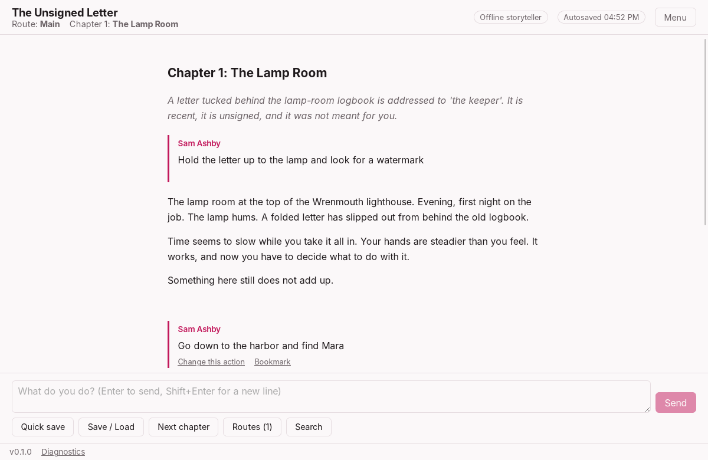
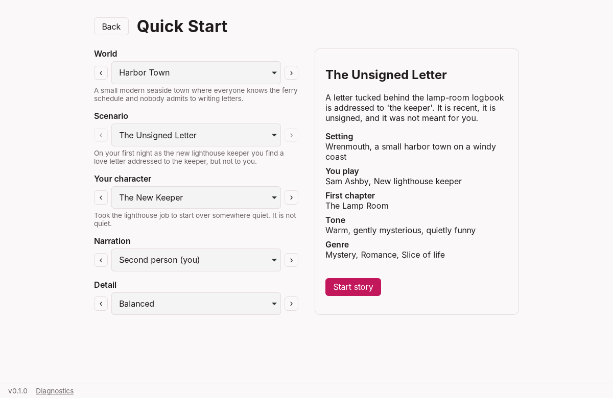
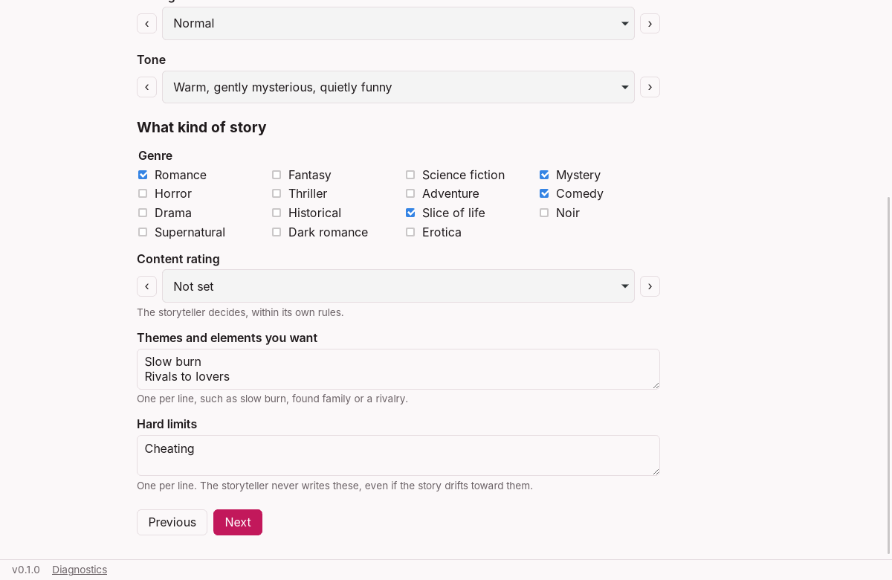

# Dear to Love

Dear to Love is a desktop app for playing interactive stories written with AI. You pick or build
a world, a character and a situation, write what you do, and the storyteller writes what
happens next. Any genre works: cozy mysteries, horror, fantasy adventures, science fiction,
romance, and explicit stories for adults.

It is local-first. Your stories, saves and pictures stay on your computer, and you bring your
own AI: a cloud service with your API key, or a model running on your own computer. A built-in
offline storyteller lets you try everything without either.



## What you can do

- **Start in three clicks** with Quick Start: pick a world, a scenario and who you play.
- **Build your own story** step by step: world, character, opening scene, other characters,
  chapter plan, narration style, genre, content rating, themes and hard limits. _Guided_ needs
  no typing; _Custom_ starts from empty fields with no presets, so you write everything.
- **Play** by typing what you do. Save anywhere, quick-save with Ctrl/Cmd+S, and five
  autosaves keep your place.
- **Branch** from any point, ask for **another reply**, or **change an earlier action**. Each
  makes a new route and leaves the original as it was.
- **Change the story as you go** in **Story details**: characters, world, narration, the scene
  and facts the storyteller must keep to. Changes apply from that point, on that route only.
- **Long stories just work.** Older turns are summarized automatically, so a story can run for
  thousands of turns. **Preview context** shows exactly what the AI will read.
- **Pictures**: portraits, backgrounds and covers from your own images.
- **Search and bookmarks** within a route.
- **Share and keep**: export a route as text, or a whole story as a `.storypack` file to import
  on another computer. Automatic daily backups, and a full backup file you can restore anywhere.
- **Know the cost**: every AI request is logged with its token count and estimated price, with
  an optional monthly budget that warns or pauses paid replies.

## Examples

### Quick Start

**New story** opens Quick Start. Choose a world, a scenario and a character with the arrows,
then **Start story**. The story opens with its premise and the opening scene, and you write
your first action.



Eight worlds are included, each with its own scenario:

| World             | Genres                          | Scenario                |
| ----------------- | ------------------------------- | ----------------------- |
| Harbor Town       | Mystery, Romance, Slice of life | The Unsigned Letter     |
| The Glass Orchard | Fantasy, Drama                  | The Memory Harvest      |
| Meridian Station  | Science fiction, Mystery        | Night Shift on Meridian |
| Ashcombe, 1923    | Historical, Romance, Comedy     | The Summer Guest        |
| Hollow Pines      | Horror, Mystery                 | Dead Air                |
| The Ember Road    | Fantasy, Adventure              | The Last Caravan        |
| Larkport          | Romance, Comedy, Drama          | The Wrong Reservation   |
| Vesper City       | Science fiction, Noir, Thriller | Ghost in the Ledger     |

### Playing

You write actions in plain words, as long or short as you like. With a connected model, an
exchange might read:

> **You:** Hold the letter up to the lamp and look for a watermark.
>
> **Storyteller:** The paper glows amber. Pressed into the fibers, faint as breath, is a crest:
> a gull over three waves. You have seen it before, on the ferry office door…

Speech works too: `"Who wrote this?" I ask Mara.` The storyteller plays everyone else and never
decides what your character does.

### Making your own kind of story

**Create your own** walks through five steps. In **Narration** you tell the storyteller what
kind of story this is:



- **Genre**: any mix, such as _Horror + Romance_, or type your own in Custom mode.
- **Content rating**: _All ages_, _Mature_ (violence, horror, strong language, sex without
  explicit detail) or _Adults only_ (explicit).
- **Themes and elements you want**: for example `slow burn`, `found family`, `rivals to
lovers`, or kinks and fetishes in an adults-only story.
- **Hard limits**: things the storyteller must never write, such as `gore` or `cheating`.

All of it is sent with every reply, and you can change it later in **Story details**.

### Adults-only stories

Adult fiction is supported, including erotica and fetish content between adults. Choosing
_Adults only_ asks once that you are 18 or older. Every character in an adults-only story must
be an adult: the app refuses characters whose age reads as under 18, and the storyteller is
always told never to write sexual content involving minors.

Whether a model actually writes explicit scenes depends on the provider. Many hosted services
refuse and have usage policies against it; local models through Ollama or LM Studio follow
your settings and keep everything on your computer. Check your provider's terms.

## Install

> **Downloads appear on the [Releases page](https://github.com/TheMiniMingg/Dear-To-Love/releases)
> once the first version is published.** Until then, [build it from source](#build-from-source).

| System                          | File                                                             |
| ------------------------------- | ---------------------------------------------------------------- |
| Windows 10/11 (64-bit)          | `…_x64-setup.exe` (installs for you only) or `…_x64_en-US.msi`   |
| macOS (Apple silicon and Intel) | `…_universal.dmg`: open it and drag Dear to Love to Applications |
| Debian, Ubuntu (64-bit)         | `…_amd64.deb`: `sudo apt install ./Dear.to.Love_…_amd64.deb`     |
| Fedora, openSUSE (64-bit)       | `….x86_64.rpm`                                                   |
| Other Linux (64-bit)            | `…_amd64.AppImage`: `chmod +x` it and run it                     |

Each release lists SHA-256 checksums in `SHA256SUMS.txt`.

### Opening an unsigned build

The builds are not code-signed yet, so your system warns you the first time:

- **Windows:** SmartScreen says it "protected your PC". Choose **More info → Run anyway**.
- **macOS:** right-click the app → **Open**, or System Settings → Privacy & Security →
  **Open Anyway**. If macOS says the app "is damaged", run
  `xattr -dr com.apple.quarantine "/Applications/Dear to Love.app"` in Terminal once.
- **Linux AppImage:** some distributions need `libfuse2` (`sudo apt install libfuse2`).

Installing a newer version keeps your stories. The app never updates itself; turn on update
checks in **Settings → Updates** to be told when a new release is out.

## Connect an AI

Open **Settings → AI connections → Add connection**:

| Choice                             | What you need                                          | Cost          |
| ---------------------------------- | ------------------------------------------------------ | ------------- |
| **Offline storyteller** (built in) | Nothing. Short, simple replies for trying things out   | Free          |
| **Ollama** on your computer        | [Ollama](https://ollama.com) and `ollama pull <model>` | Free, private |
| **LM Studio** on your computer     | [LM Studio](https://lmstudio.ai) with its server on    | Free, private |
| **OpenAI**                         | An API key and a model name                            | Paid per use  |
| **OpenRouter**                     | An API key; one key reaches many models                | Paid per use  |
| **Other**                          | Any OpenAI-compatible address, key and model name      | Varies        |

Keys are kept in your system's credential store (Windows Credential Manager, macOS Keychain,
Linux Secret Service), never in story files, exports or backups. **Test connection** checks a
connection for free. Then pick it as the **Storyteller** in Settings or from the reader.

Set the **context limit** to what your model can read: a bigger limit lets the storyteller see
more of the story at once. Costs are estimates from prices you enter under **Usage & budget**;
set a spending limit in your provider's dashboard too.

## Your data, and what happens when it fills up

Everything lives in the app's data folder (Windows `%APPDATA%\io.github.theminimingg.deartolove`,
macOS `~/Library/Application Support/io.github.theminimingg.deartolove`, Linux
`~/.local/share/io.github.theminimingg.deartolove`): one SQLite database, your pictures, and
automatic backups.

- **Stories have no length limit.** Older turns are summarized every 8 replies; the newest
  turns are always sent word for word. If even the story setup cannot fit the model's context,
  the app says so before sending anything.
- **A full disk loses nothing.** The change that could not be saved is rolled back, you are told
  plainly, and automatic backups pause until there is room. **Diagnostics** warns when space is
  low.

[How it works](docs/how-it-works.md) explains storage, memory, limits and workarounds,
templates and content settings in detail.

## Build from source

You need [Node.js 22](https://nodejs.org), [pnpm](https://pnpm.io), [Rust](https://rustup.rs)
and the [Tauri prerequisites](https://v2.tauri.app/start/prerequisites/) for your system.

```sh
git clone https://github.com/TheMiniMingg/Dear-To-Love.git
cd Dear-To-Love
pnpm install
pnpm tauri dev          # run it
pnpm tauri build        # make an installer for this system
```

More in [`docs/dev.md`](docs/dev.md); releases are described in
[`docs/release.md`](docs/release.md).

## Help and development

- Problems and ideas: [GitHub issues](https://github.com/TheMiniMingg/Dear-To-Love/issues).
  Attach the report from **Diagnostics → Copy report…**: it never contains story text, keys or
  file paths.
- How it works: [`docs/how-it-works.md`](docs/how-it-works.md). Architecture and decisions:
  [`docs/architecture.md`](docs/architecture.md), [`docs/adr/`](docs/adr/),
  [`docs/roadmap-v4.md`](docs/roadmap-v4.md) and
  [`docs/roadmap-decisions.md`](docs/roadmap-decisions.md).
- License: [MIT](LICENSE).
